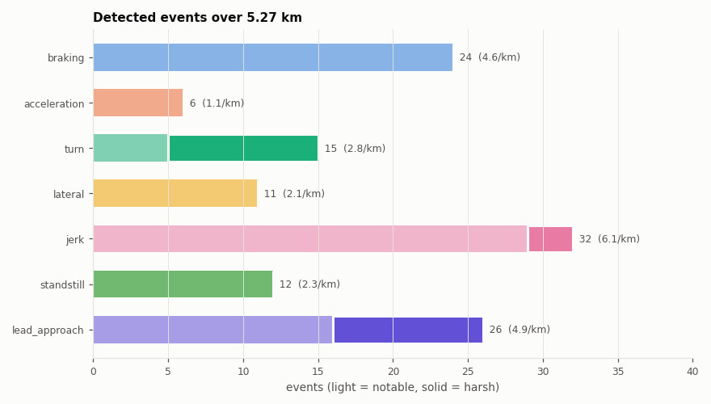
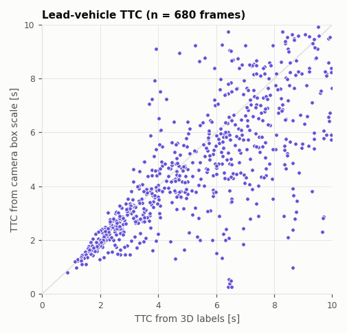
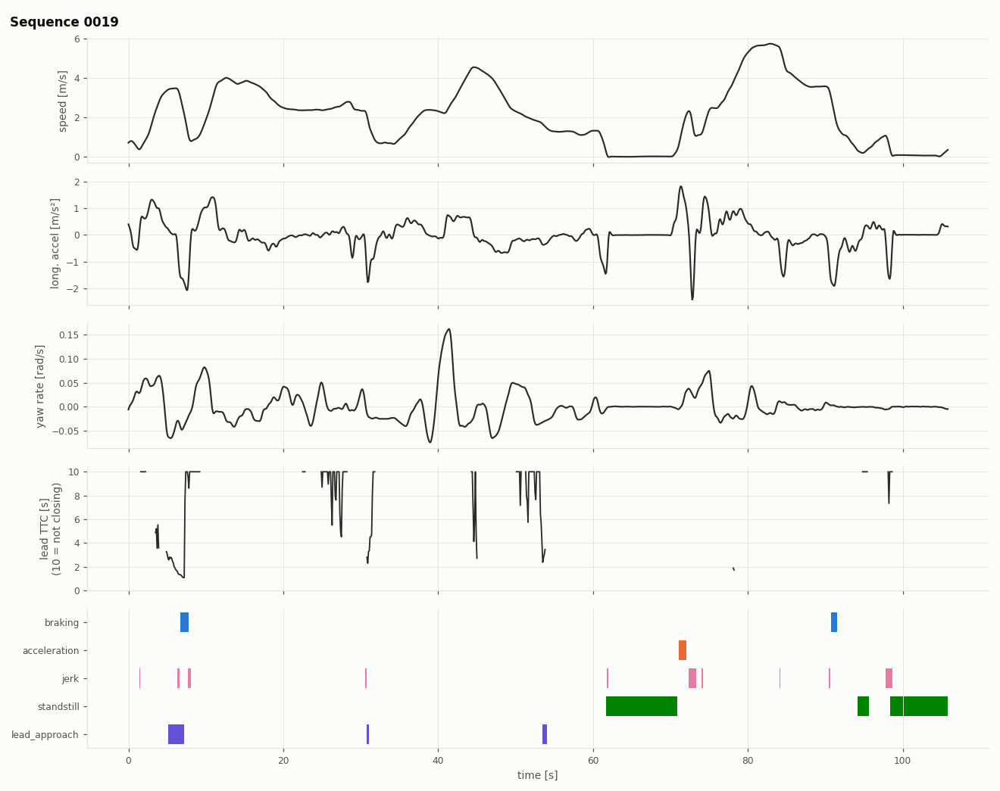
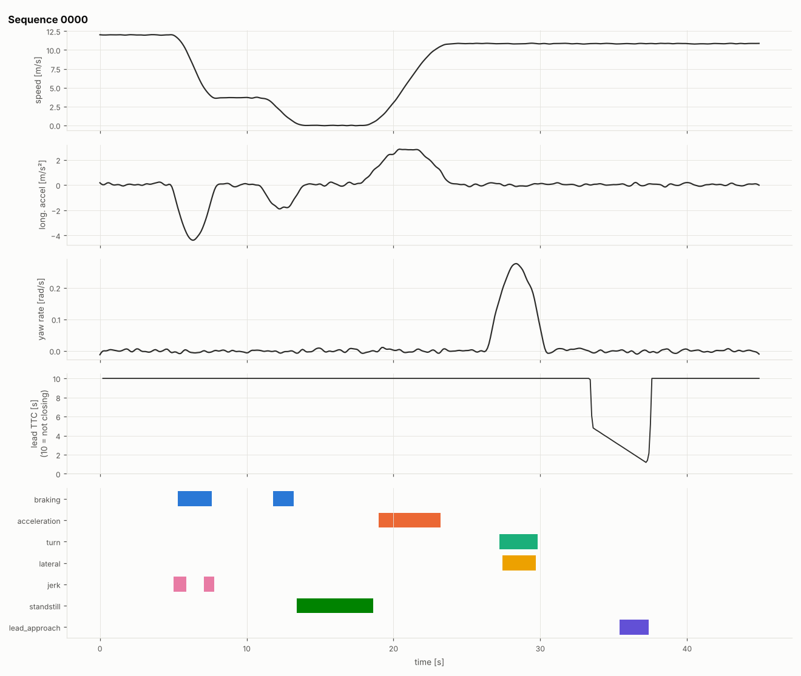
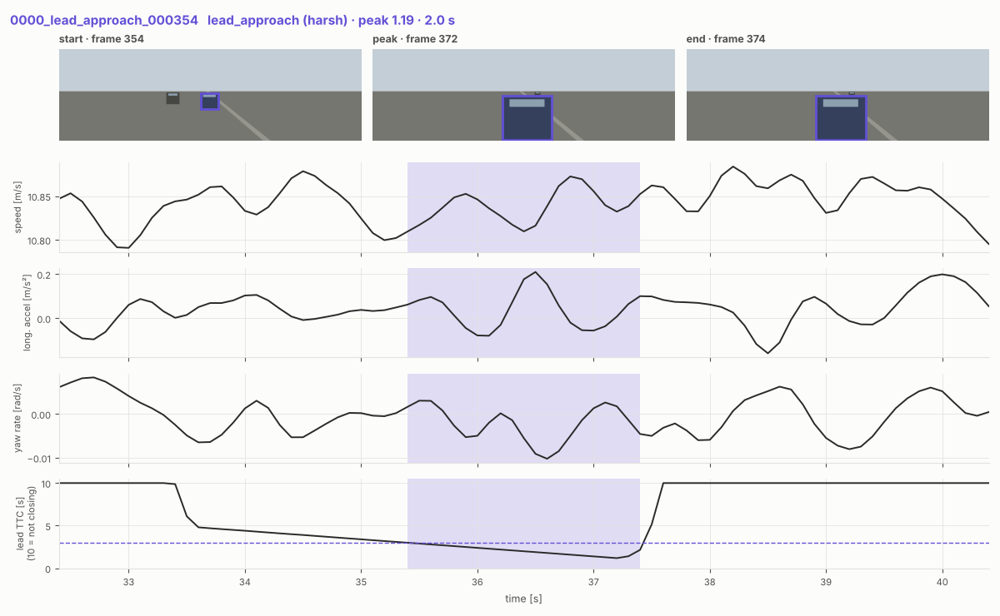
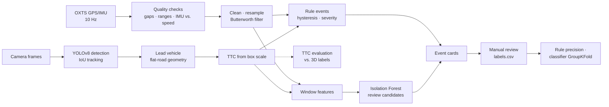

# Driving-event mining on KITTI

**Detection and semi-automatic labeling of safety-relevant driving events from synchronized camera and vehicle-dynamics data.**

[](https://github.com/sandraesudhakaran-creator/kitti-drive-event-mining/actions/workflows/ci.yml)
[](https://colab.research.google.com/github/sandraesudhakaran-creator/kitti-drive-event-mining/blob/main/notebooks/colab_walkthrough.ipynb)

Test drives produce hours of video and vehicle signals. Only a few seconds of them matter for safety analysis: a hard brake, a fast approach to the car ahead, an abrupt steering input. This project builds the processing chain that finds those moments and prepares them for review:

- **Signal processing.** OXTS GPS/IMU data goes through plausibility and timing checks, gap-aware resampling and zero-phase Butterworth filtering. The IMU acceleration is cross-checked against the derivative of the measured speed.
- **Rule-based event detection** with hysteresis, merging and severity levels:
  - braking
  - acceleration
  - turns
  - lateral acceleration
  - jerk
  - standstill
- **Video analysis:**
  - YOLOv8 vehicle detection and IoU/Hungarian tracking
  - lead-vehicle selection on the road plane
  - **monocular time-to-collision** from bounding-box expansion, evaluated against the KITTI 3D labels
- **Pattern recognition:**
  - sliding-window features
  - an Isolation Forest that surfaces unusual driving the rules missed
  - a Random Forest classifier, cross-validated by drive (GroupKFold)
- **Labeling workflow:**
  - event cards that show camera frames and signals together
  - a notebook review tool (accept / reject / relabel) with an audit log
  - rule precision and classifier evaluation from the reviewed labels (review not yet carried out, see Results)

## Results

All 21 KITTI tracking training sequences were processed: 13.3 min of urban driving over 5.27 km in Karlsruhe.

**Events.** The rules flagged 126 candidate events:

| type | count | harsh | median duration |
|---|---:|---:|---:|
| braking | 24 | 0 | 1.4 s |
| acceleration | 6 | 0 | 1.9 s |
| turn | 15 | 10 | 3.5 s |
| lateral | 11 | 0 | 1.9 s |
| jerk | 32 | 3 | 0.2 s |
| standstill | 12 | 0 | 7.6 s |
| lead_approach | 26 | 10 | 0.9 s |

The jerk rule needs attention. Its median duration equals the minimum allowed (0.2 s), which suggests many of these events are noise crossing the threshold rather than real manoeuvres. Manual review is the planned way to measure this before tuning.

**Data quality.** KITTI OXTS data had no timing gaps and no implausible samples. The IMU acceleration agreed with the derivative of the measured speed to 0.002–0.05 m/s² RMSE per sequence, with bias below 0.02 m/s². Three sequences (0012, 0016, 0017) show near-zero residuals because the ego vehicle is almost stationary.

<p align="center"></p>

**Camera TTC vs. 3D labels.** The pipeline ran twice: once with YOLOv8n, and once with the labelled boxes as a perfect detector ("oracle"). This separates the error of the TTC method from the error of the detector.

| | YOLOv8n | Oracle boxes |
|---|---:|---:|
| Lead-vehicle selection, recall / precision | 0.84 / 0.91 | 1.00 / 1.00 |
| TTC median absolute error | 0.63 s | 0.31 s |
| TTC median relative error | 14.5 % | 6.4 % |
| Critical warning (TTC < 3 s), precision / recall | 0.69 / 0.92 | 0.90 / 0.98 |
| lead_approach events | 26 | 14 |

With stable boxes, the scale-based TTC is accurate: 6 % median error. Most of the error under YOLO comes from frame-to-frame box jitter. The method reads jitter as rapid growth, which creates short false approach alarms: 26 events instead of 14, with half the median duration. Recall of critical moments stays high at 92 %, but precision drops to 69 %. The next steps are temporal smoothing of box size and a minimum track age.

<p align="center"></p>

<p align="center"><br>
<em>KITTI sequence 0019: filtered signals, lead-vehicle TTC and detected events per type.</em></p>

<p align="center"><br>
<em>Review card: camera at start / peak / end with the lead-vehicle box, signals and threshold.</em></p>

**Not done yet.** The review tool and the grouped-CV classifier are implemented and tested, but the KITTI events have not been manually reviewed. So there is no measured rule precision, and the classifier has not been trained on human labels.

**Pipeline check on synthetic data.** This one is already measured: CI runs it on every push. On simulated drives with sensor noise, IMU bias and faulty samples, the pipeline recovers all injected events (27/27, no false positives). The camera TTC median relative error is 7 % with the oracle detector. This verifies the processing chain, not real-world performance.

<p align="center"><br>
<em>Synthetic drive: filtered signals and the detected events per type.</em></p>

<p align="center"><br>
<em>Review card for a lead-vehicle approach: frames at start / peak / end, signals and the TTC threshold.</em></p>

## Pipeline



## Method notes

**Why filter, and how.** The IMU is noisy at 10 Hz. Differentiating it for jerk amplifies the noise further. A 2nd-order Butterworth low-pass at 1.5 Hz is run forward and backward (`filtfilt`), which gives zero phase shift, so event start times are not delayed. The filter is applied separately to each valid segment so it never smears across a data gap. Gaps longer than 0.5 s stay empty instead of being interpolated.

**Hysteresis instead of a single threshold.** An event starts at the threshold (e.g. −1.5 m/s²) and ends only when the signal recovers past 70 % of it. Without this, noise around the threshold splits one braking manoeuvre into several short events.

**TTC without depth.** For a pinhole camera, box size ∝ 1/distance, so `d ln(size)/dt = 1/TTC`. The slope is a least-squares fit over the last 5 frames of a track. This needs no depth estimate and no calibration, but it assumes a constant closing speed. The labels give the reference: `TTC = z / (−dz/dt)` from the 3D positions.

**Choosing the lead vehicle.** A car parked at the kerb 30 m ahead appears near the image centre. A pixel corridor therefore picks it as "lead" and raises false TTC alarms. Each box is instead projected onto the road with the flat-ground assumption (camera height 1.65 m). Only vehicles within ±1.8 m laterally count as in-lane.

**No leakage in evaluation.** Windows overlap by 75 % and neighbouring windows are almost identical. A random train/test split would put near-copies on both sides. Cross-validation is therefore grouped by drive.

**Rules vs. learning.** A classifier trained on rule labels can at best reproduce the rules. It is trained on human-reviewed labels instead, and the review is also what measures rule precision.

## Quick start

```bash
pip install -e ".[dev]"            # add [video] for YOLO, [review] for the notebook tool

# synthetic KITTI-format data with known ground truth
drive-events synth --out data/synthetic --n 3
drive-events run --data-root data/synthetic --out outputs/demo --detector ground_truth
drive-events evaluate --events outputs/demo/events.csv --truth data/synthetic/truth_events.csv

# real KITTI tracking data (layout: <root>/training/{oxts,label_02,calib,image_02})
drive-events run --data-root data/kitti_tracking --out outputs/kitti --detector yolo
drive-events evaluate-labels --run outputs/kitti --labels labels.csv

pytest                             # unit + end-to-end tests
```

For the full walkthrough on a free GPU, including review, see [`notebooks/colab_walkthrough.ipynb`](notebooks/colab_walkthrough.ipynb).

All parameters are in [`configs/default.yaml`](configs/default.yaml):
- thresholds
- filter settings
- TTC window
- camera height
- window length

## Outputs

| File | Content |
|---|---|
| `events.csv` | one row per event: type, severity, start/end/peak time and frame, peak value |
| `quality.csv` | per drive: time gaps, faulty samples, IMU–speed consistency RMSE and bias |
| `windows.csv` | window features, rule label, anomaly score |
| `review_candidates.csv` | most unusual windows that no rule flagged |
| `cards/` | review card per event (and per candidate) |
| `ttc_per_frame.csv` | predicted vs. label TTC per frame |
| `figures/` | timelines, event overview, TTC scatter |
| `summary.md` | key numbers of the run |

## Project structure

```
src/drive_events/
  io/kitti.py          KITTI tracking + raw readers (OXTS, labels, calibration)
  signals.py           quality checks, cleaning, resampling, filtering
  events.py            rule-based event detection
  video/               YOLO wrapper, IoU tracker, lead vehicle, TTC + evaluation
  features.py          sliding-window features and labels
  models.py            Isolation Forest, grouped-CV classifier
  labeling/            event cards, label store, notebook review widget
  evaluation.py        event matching (interval IoU), precision/recall
  synthetic.py         KITTI-format simulator with ground truth
  pipeline.py, cli.py  orchestration and command line
tests/                 pytest suite (runs without data or GPU)
```

## Limitations

- **OXTS is not a vehicle bus.** There is no brake pedal, steering angle or ADAS state, so braking is inferred from deceleration only.
- **KITTI driving is calm and short.** Harsh events are rare, so per-type statistics rest on small counts.
- **Monocular TTC assumptions.** It assumes constant closing speed and a stable box, so it degrades for turning vehicles, partial occlusion and truncation at the image border.
- **Flat-road lead selection** breaks on slopes and in tight curves.
- **No manual review yet.** Rule precision on KITTI is unmeasured, and with a single reviewer there would be no inter-rater agreement.

## Data and licence

Code: MIT. KITTI is © Karlsruhe Institute of Technology and Toyota Technological Institute at Chicago. It is licensed CC BY-NC-SA 3.0 and is **not** included in this repository. Download it from <https://www.cvlibs.net/datasets/kitti/>.

> A. Geiger, P. Lenz, R. Urtasun. *Are we ready for autonomous driving? The KITTI vision benchmark suite.* CVPR 2012.
